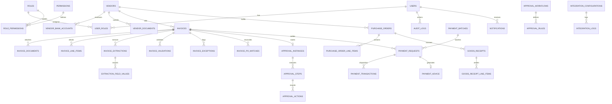

# Enterprise Accounts Payable (AP) Automation Platform with OCR & AI

A production-grade, full-stack Accounts Payable (AP) Automation platform engineered with Python FastAPI, React 18, TypeScript, Tailwind CSS, PostgreSQL / SQLite, SQLAlchemy, Alembic migrations, Tesseract OCR, and mock integration adapters.

The application automates the end-to-end invoice-to-payment lifecycle: invoice capture (PDF, images, bulk, email ingestion), OCR & AI structured field extraction, split-screen review and revision tracking, multi-factor validation (duplicate detection, GST tax calculations, vendor master checks), 2-way and 3-way PO & GRN matching, configurable multi-tier approval workflows with strict **maker-checker governance**, batch payment processing with mock banking gateways, payment advice vouchers, real-time analytics, and tamper-evident audit logging.

---

## Architecture Overview

```mermaid
flowchart TD
    subgraph CaptureLayer ["1. Ingestion & Document Capture"]
        Upload["Single & Bulk File Upload (PDF, PNG, JPG, TIFF)"]
        EmailConnector["Email Connector Ingestion Simulator"]
        Storage["Secure File Storage with SHA-256 Deduplication"]
    end

    subgraph ProcessingLayer ["2. OCR & Structured Extraction"]
        OCR["Hybrid OCR & Text Extraction Engine"]
        AIExtract["AI Structured Document Field Extraction"]
        OCRReview["OCR Review & Side-by-Side Verification Workbench"]
    end

    subgraph GovernanceLayer ["3. Validation & 3-Way Matching"]
        ValEngine["Validation Engine (GSTIN, Math, Inactive Vendor, Duplicates)"]
        MatchEngine["Matching Engine (2-Way PO / 3-Way GRN Reconciliation)"]
        ExceptionMgmt["Exception Resolution & Audit Comments"]
    end

    subgraph WorkflowLayer ["4. Governance & Approval Matrix"]
        Matrix["Configurable Multi-Tier Amount & Dept Rules"]
        MakerChecker["Strict Maker-Checker Separation of Duties"]
        ApprovalInbox["Approver Inbox (Approve, Reject, Request Changes)"]
        PaymentGate["Payment Readiness Gate (All validations & approvals passed)"]
    end

    subgraph SettlementLayer ["5. Banking & Payment Settlement"]
        BatchQueue["Payment Run Batching Queue"]
        BankGateway["Mock Corporate Banking Gateway (ACH / NEFT / RTGS)"]
        PaymentAdvice["Payment Advice Generation with Statutory TDS Deductions"]
    end

    subgraph AnalyticsLayer ["6. Analytics & Compliance"]
        Dashboard["Real-Time Database Aggregated Dashboard"]
        Reports["AP Aging Schedules & Tax Reports (CSV / Excel)"]
        AuditTrail["Tamper-Evident Immutable Audit Log"]
    end

    CaptureLayer --> ProcessingLayer
    ProcessingLayer --> GovernanceLayer
    GovernanceLayer --> WorkflowLayer
    WorkflowLayer --> SettlementLayer
    SettlementLayer --> AnalyticsLayer
```



---

## Database Entity-Relationship Diagram (ERD)

The database schema is normalized in PostgreSQL with foreign keys, cascading constraints, precision numeric types (`Numeric(15, 2)` for currency amounts), and audit timestamps.



---

## Role-Based Access Control (RBAC) & Maker-Checker

The application implements a 7-tier RBAC system with server-side enforcement:

| Role Name | Description | Key Permissions & Constraints |
| :--- | :--- | :--- |
| **System Administrator (`admin`)** | Full system access | Manage users, configure approval matrices, integrations, view all records. |
| **AP Manager (`ap_manager`)** | Financial supervisor | Resolves validation exceptions, overrides match discrepancies, approves tier 1/2 invoices, views reports. |
| **AP Executive / Maker (`ap_executive`)** | Invoice processing maker | Ingests documents, corrects OCR fields, submits for validation and approvals. **Cannot approve own invoices.** |
| **Approver (`approver`)** | Department supervisor | Reviews assigned department invoices, approves, rejects, requests changes. Enforces maker-checker rule. |
| **Finance Executive (`finance_executive`)** | Treasury desk | Builds payment batches, executes banking gateway settlements, generates payment advice vouchers. |
| **Vendor (`vendor`)** | External vendor portal | Submits vendor invoices, uploads onboarding compliance records, monitors payment statuses for their company only. |
| **Auditor (`auditor`)** | Read-only compliance | Read-only view of financial records, aging schedules, tax reports, and chronological audit trails. |

### Maker-Checker Enforcement
A user who creates or uploads an invoice (`uploader_id == user.id`) is strictly blocked from executing approval decisions on that invoice at the backend API layer (`HTTP 403 Forbidden: Maker-Checker Violation: You are the creator/uploader of this invoice and cannot approve it.`).

---

## Test Accounts & Credentials

All test accounts are pre-seeded in the database with the default password: `Password@123`

| Role | Email Address | Password | Department |
| :--- | :--- | :--- | :--- |
| **System Administrator** | `admin@enterprise.com` | `Password@123` | Executive |
| **AP Manager** | `manager@enterprise.com` | `Password@123` | Finance |
| **Invoice Maker (AP Exec)** | `maker@enterprise.com` | `Password@123` | Accounts Payable |
| **Department Approver** | `approver@enterprise.com` | `Password@123` | Operations |
| **Finance / Payment Exec** | `finance@enterprise.com` | `Password@123` | Treasury |
| **Vendor Portal User** | `vendor@acme.com` | `Password@123` | External |
| **Auditor** | `auditor@enterprise.com` | `Password@123` | Compliance |

> **Pro-Tip**: The frontend application includes an instant **Role Simulator Dropdown** in the top navigation bar to test maker-checker handoffs and permissions without repeatedly logging out.

---

## Quickstart & Local Setup

### Prerequisites
- Python 3.10+ (tested with Python 3.13)
- Node.js 18+ and npm
- Git

### 1. Backend Setup

```bash
# From workspace root
# Install backend dependencies
pip install -r backend/requirements.txt

# Run migrations (or initialize schema)
python -m alembic upgrade head

# Start FastAPI server on port 8000
python -m uvicorn backend.app.main:app --host 127.0.0.1 --port 8000 --reload
```

The database automatically seeds realistic vendors, purchase orders, goods receipts, approval matrices, and sample invoices upon first startup.
- Interactive API Swagger Docs: `http://127.0.0.1:8000/docs`
- Health Endpoint: `http://127.0.0.1:8000/health`

### 2. Frontend Setup

```bash
# In a new terminal, navigate to frontend
cd frontend

# Install frontend dependencies
npm install

# Start Vite development server on port 5173
npm run dev
```

Open your browser at `http://localhost:5173`.

---

## Running with Docker Compose (Production Setup)

To deploy the full containerized stack including PostgreSQL 16, Redis 7, Backend, and Frontend:

```bash
# Build and start all services
docker compose up --build -d

# Check service health
docker compose ps
```

- Frontend Web UI: `http://localhost:5173`
- Backend API: `http://localhost:8000`
- PostgreSQL Port: `5432`
- Redis Port: `6379`

---

## Automated Test Suite

Run the full automated backend test suite covering authentication, validation, duplicate checks, 3-way matching, maker-checker enforcement, and payment execution:

```bash
python -m pytest backend/tests -v
```

All 11 automated test cases run against a live transactional test database and assert exact numeric tolerances and governance rules.

---

## Realistic Sample Invoices & Test Scenarios

The repository includes ready-to-test invoices located in `sample_invoices/`:

1. **`invoice_acme_valve_po8801.pdf`**: Clean standard invoice matching PO-2026-8801 ($12,500.00). Demonstrates straight-through 3-way match.
2. **`invoice_apex_cloud_po9905.pdf`**: Standard invoice matching PO-2026-9905 ($4,800.00). Demonstrates 2-way match.
3. **`invoice_price_mismatch_exception.pdf`**: Price higher than PO by > 20%. Automatically flags a price variance exception.
4. **`invoice_gst_conflict_exception.pdf`**: Includes conflicting IGST and CGST amounts on the same invoice. Flags statutory tax conflict.
5. **`invoice_scanned_image.png`**: High-resolution image invoice demonstrating OCR extraction from raster images.

To test ingestion: Navigate to the **Invoices** tab, click **Capture Invoices**, and drag in any of the above files. Alternatively, click **Simulate Ingest from Email Connector** to ingest an invoice attachment automatically.

---

## API Reference & Endpoints

| Category | Endpoint | Method | Role Required | Description |
| :--- | :--- | :--- | :--- | :--- |
| **Auth** | `/api/v1/auth/login` | POST | Public | Authenticate user, returns access & refresh tokens |
| **Auth** | `/api/v1/auth/refresh` | POST | Public | Generates new access token from refresh token |
| **Auth** | `/api/v1/auth/me` | GET | Authenticated | Current user profile and assigned roles |
| **Invoices**| `/api/v1/invoices/upload` | POST | Maker/Manager/Vendor | Uploads single/bulk invoices, runs OCR, validates |
| **Invoices**| `/api/v1/invoices` | GET | Authenticated | List all invoices with filters (vendor, status, search) |
| **Invoices**| `/api/v1/invoices/{id}/ocr-correct` | POST | Maker/Manager | Updates extracted fields, logs revision audit trail |
| **Invoices**| `/api/v1/invoices/{id}/validate` | POST | Authenticated | Runs validation engine against statutory rules |
| **Invoices**| `/api/v1/invoices/{id}/match` | POST | Authenticated | Runs 2-way and 3-way PO & GRN matching engine |
| **Invoices**| `/api/v1/invoices/{id}/submit-approval`| POST | Maker/Manager | Initiates multi-tier approval matrix |
| **Exceptions**| `/api/v1/validations/exceptions` | GET | Authenticated | Lists all active validation exceptions |
| **Exceptions**| `/api/v1/validations/exceptions/{id}/resolve`| POST | AP Manager/Admin | Resolves exception with justification notes |
| **Matching**| `/api/v1/matching` | GET | Authenticated | Lists all PO & GRN match results |
| **Matching**| `/api/v1/matching/{id}/override` | POST | AP Manager/Admin | Authorizes price/quantity variance override |
| **Workflows**| `/api/v1/workflows/inbox` | GET | Approvers | Pending approval tasks (maker-checker filtered) |
| **Workflows**| `/api/v1/workflows/action/{invoice_id}` | POST | Authorized Approver | Approve, reject, or request changes |
| **Payments**| `/api/v1/payments/ready` | GET | Finance/Admin | Invoices approved & payment-ready |
| **Payments**| `/api/v1/payments/batch` | POST | Finance/Admin | Bundles multiple approved invoices into payment run |
| **Payments**| `/api/v1/payments/execute/{req_id}`| POST | Finance/Admin | Executes banking settlement via mock gateway |
| **Reports** | `/api/v1/reports/aging` | GET | Authenticated | AP Aging Schedule (0-30, 31-60, 61-90, 90+ days) |
| **Reports** | `/api/v1/reports/export/{type}` | GET | Authenticated | Exports financial report to CSV or Excel (`.xlsx`) |
| **Audit** | `/api/v1/audit/logs` | GET | Auditor/Manager/Admin | Tamper-evident immutable audit trail |
| **Integrations**| `/api/v1/integrations/{name}/test` | POST | AP Manager/Admin | Tests live connectivity to ERP / Banking adapter |

---

## Known Limitations & Future Enterprise Roadmap
1. **Cloud OCR Connectors**: The platform uses a local digital parser and Tesseract wrapper. Configuration hooks are provided for AWS Textract and Google Document AI.
2. **Direct Bank H2H (Host-to-Host)**: Real banking settlement uses ISO 20022 XML or SFTP host-to-host links. The system currently features a mock adapter simulating real corporate banking callbacks, UTR tracing, and failure rollbacks.
3. **ERP Two-Way Webhooks**: ERP data sync currently runs via scheduled and manual REST endpoints; bi-directional webhooks can be enabled with dedicated ERP plugins (e.g. SAP NetWeaver / Oracle NetSuite).
